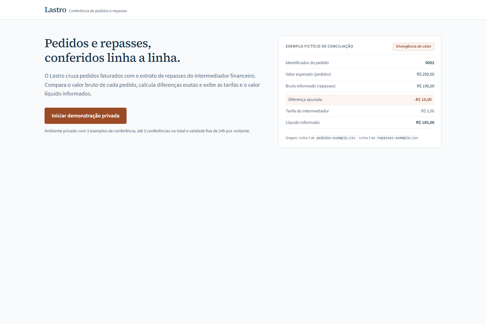
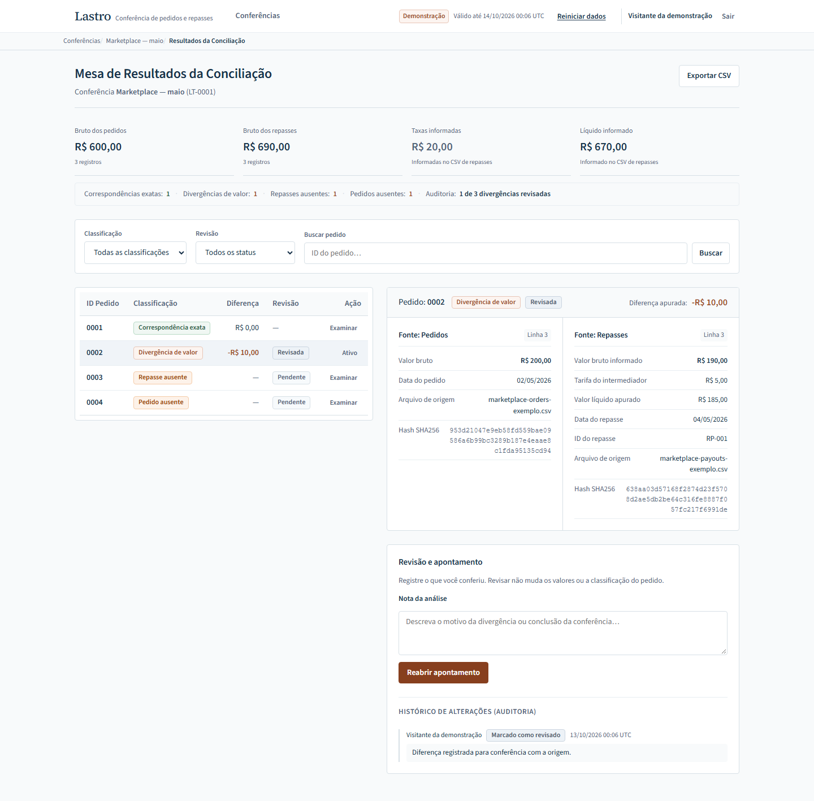
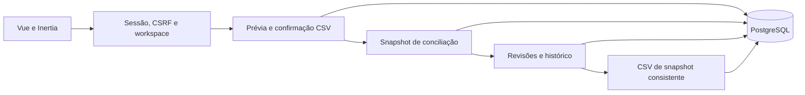

# Lastro

Conferência de pedidos e repasses com Vue, Laravel e PostgreSQL. Importe dois
CSVs, encontre diferenças de valor ou identificadores ausentes, registre uma
revisão e exporte o resultado sem perder a origem dos dados.

Projeto de portfólio de **Diogo Pereira**. A demonstração usa dados fictícios;
não há integração bancária, movimentação de dinheiro ou certificação de repasse.
Implementação local verificada; publicação e CI remoto ainda em andamento.





## O percurso

1. Inicie a demonstração privada. Dois exemplos mostram correspondência
   exata, diferença de valor e registros sem correspondência; o terceiro
   aguarda importação para você experimentar o percurso desde o início.
2. Crie uma conferência para 01/05/2026–31/05/2026 e baixe os exemplos CSV.
3. Importe pedidos e repasses. A prévia localiza erros por linha/campo; só um
   lote válido pode ser confirmado. A primeira fonte fecha o período.
4. Concilie e examine o pedido **0002**: esperado **R$ 200,00**, informado
   **R$ 190,00**, diferença **−R$ 10,00**. Confira arquivo, linha, hash e valores originais.
5. Registre uma nota e revise. A divergência continua sendo uma divergência;
   a revisão é um evento separado. Reabra com motivo quando necessário.
6. Baixe o CSV e recarregue a aplicação para conferir a persistência.

## Comportamento que merece ser examinado

- Identificadores são texto exato: `0001` e `1` não se tornam o mesmo pedido.
- Dinheiro é convertido em centavos inteiros de 64 bits no servidor. A interface
  recebe strings decimais e apenas as formata.
- CSV estrito antes do parser: UTF-8/BOM/LF/CRLF, aspas/largura/cabeçalho,
  período, duplicidade, taxa/líquido e limites são validados sem lote parcial.
- Confirmar o mesmo conteúdo preserva fonte, nome e evento, mesmo depois de
  renomear o arquivo ou alterar representação equivalente. Conteúdo diferente recebe HTTP 409.
- Conciliação idempotente cria um snapshot com quatro classificações. Filtros
  e paginação não mudam os totais globais ou as linhas exportadas.
- Revisão exige versão atual e nota válida; atualização/evento são atômicos.
  Duas revisões concorrentes produzem uma vencedora e um conflito HTTP 409.
- Exportação materializa um snapshot PostgreSQL REPEATABLE READ. Campos
  textuais recebem proteção de fórmula; diferença monetária negativa permanece
  decimal. Resultados pendentes também são exportados.
- Visitantes têm namespaces separados. Reset revoga a geração anterior,
  invalida sessões e recusa rascunho de outra aba mesmo com cookie novo.

## Arquitetura

Monólito modular no mesmo domínio: Vue/Inertia para interface, Laravel para
sessão/CSRF/validação e serviços de domínio, PostgreSQL para dados, sessões,
cache e locks. Sem serviços de negócio simulados no navegador.



Serviços bloqueiam workspace e depois o objeto de negócio. Revogação e validade
são verificadas pelo relógio do banco antes/depois da operação. Constraints/FKs
compostas e triggers protegem associações e snapshots. Cache/locks e sessões
compartilhados permitem operar entre instâncias sem depender de disco local.

## Executar localmente

Requisitos: PHP 8.5 de 64 bits com PDO PostgreSQL, Composer 2, Node 24.15 e PostgreSQL 17.
Versões e decisões dos locks em [ambiente](docs/decisions/environment.md).

```sh
composer install
npm ci
cp .env.example .env
php artisan key:generate
# Configure DB_* e credenciais próprias em .env antes de migrar.
php artisan migrate
npm run build
php artisan serve
```

Para demo, defina `LASTRO_DEMO_ENABLED=true`. Para instalação normal, mantenha
false e configure `LASTRO_STAFF_EMAIL`, `LASTRO_STAFF_PASSWORD` (pelo menos 12 caracteres)
e `LASTRO_STAFF_NAME`; execute `php artisan db:seed` explicitamente. Nenhum
usuário/senha padrão é instalado. Startup não migra nem faz seed automático.

No ambiente Windows preparado, [bootstrap](scripts/bootstrap.ps1) e
[dev](scripts/dev.ps1) usam runtimes portáteis e `.local/settings.json` ignorado.
O serviço PostgreSQL deve estar disponível antes de rodar esses scripts.

## Verificar

Use um banco próprio de teste `lastro_test` e role com mesmo nome, separado do
desenvolvimento. Os testes precisam de PostgreSQL real e permissão para schemas
temporários; não há fallback SQLite nem skip quando o banco está indisponível.

```powershell
./scripts/verify.ps1
```

Fora do Windows preparado, configure o ambiente de teste e execute Composer
validate/check-platform-reqs, Pint, PHPUnit, typecheck, Vitest, build e Playwright.
A [CI](.github/workflows/ci.yml) prepara banco com role sem superuser, instala
dos locks e percorre o mesmo caminho. Rodar localmente não declara CI remoto.

Verificado em 12/10/2026: **283 testes PHP / 1.315 assertions**, **36 testes
frontend** e **4 cenários Playwright**. Disputas usam processos/conexões
independentes e bloqueio observado no PostgreSQL; há controle negativo da quota.
Sessão/CSRF foram testados em duas instâncias HTTP separadas. Evidências em
[progresso](docs/evidence/progress.md) e relatórios de tarefas.

## Limites da demonstração e do formato

Ambiente privado, cinco conferências incluindo três exemplos, arquivo até
1.048.576 bytes e 100 registros. Validade fixa de 24 horas por geração, reset limitado e
coleta de gerações vencidas/revogadas. Modelos são vazios; exemplos são de
maio de 2026. Use arquivos fictícios ao testar.

Uma linha de repasse por pedido, BRL e comparação exata do bruto. Sem parcelas,
split, reembolso, câmbio ou avaliação da taxa contratada. A aplicação mostra
taxa/líquido informados e valida sua aritmética; não confere extrato bancário.

CSV exportado contém uma linha por resultado com cabeçalho fixo. Não há rodapé
de totais ou linhas sintéticas; totais e origem/hash ficam na interface. A
proteção de fórmula foi testada por parsing do arquivo, sem executar Excel.

## Documentação

[HTTP](docs/contracts/http.md) · [CSV](docs/contracts/csv.md) ·
[projeções](docs/contracts/projections.md) · [design](DESIGN.md) ·
[hospedagem](docs/decisions/hosting.md) ·
[especificação](docs/superpowers/specs/2026-10-10-lastro-design.md)
